# クリストファー 公式サイト

お笑い芸人クリストファーの公式ホームページです。ライブの出演情報、プロフィール、各種リンクを掲載します。

> [!NOTE]
> 現在は公開準備中です。

## 🏗️ システム構成



## 🗂️ データの置き場所

| 情報 | 置き場所 | 更新方法 | サイトへの反映 |
| --- | --- | --- | --- |
| 📅 ライブ出演情報 | Google カレンダー | 予定を登録 | 最長 10 分後 |
| 👤 プロフィール | `src/content/` の Markdown | GitHub へ push | デプロイ後 |
| 🔗 各種リンク | `src/data/links.ts` | GitHub へ push | デプロイ後 |
| 🖼️ 画像 | `src/assets/` | GitHub へ push | デプロイ後 |

## 📁 プロジェクト構成

```text
src/
├── pages/         # トップ（全セクション）、告知画像の作成
├── components/    # 共通コンポーネント
├── layouts/       # 共通レイアウト
├── lib/           # Google カレンダーの取得、整形、キャッシュ
├── content/       # プロフィールの Markdown
├── data/          # 各種リンク
└── assets/        # 画像
```

## 🛠️ 技術スタック

| 用途 | 技術 |
| --- | --- |
| フレームワーク | [](https://astro.build/) [](https://www.typescriptlang.org/) |
| スタイル | [](https://tailwindcss.com/) |
| ホスティング | [](https://workers.cloudflare.com/) |
| スケジュールのデータ | [](https://developers.google.com/calendar) |
| ソース管理、自動デプロイ | [](https://github.com/) |

## 💻 ローカルでの起動

Node.js のバージョンは `.node-version` を参照してください（22.23.4 以上が必要です）。

依存パッケージをインストールします。

```bash
npm install
```

`.dev.vars.example` をコピーして `.dev.vars` を作成し、Google カレンダーの接続情報を設定します。このファイルはコミットしないでください。

```bash
cp .dev.vars.example .dev.vars
```

開発サーバーを起動します。

```bash
npm run dev
```

## ✅ テスト

```bash
npm run check
npm run lint
npm test
```

## 🚀 デプロイ

本番の接続情報を Cloudflare に登録します。ダッシュボードで登録する場合も、Type は「Secret」にします。
「Text」で登録した変数は `wrangler.jsonc` に書かれていないため、デプロイで消えることがあります。

```bash
npx wrangler secret put GOOGLE_CALENDAR_API_KEY
npx wrangler secret put GOOGLE_CALENDAR_ID
```

公開 URL を指定してビルドし、デプロイします。

```bash
SITE_URL=https://example.com npm run deploy
```

### 自動デプロイ

`main` へ push（マージ）すると、GitHub Actions がチェックのあとに本番へデプロイします。
リポジトリの Settings に次を登録しておきます。

| 種類 | 名前 | 内容 |
| --- | --- | --- |
| Secret | `CLOUDFLARE_API_TOKEN` | Cloudflare の API トークン（「Edit Cloudflare Workers」テンプレート） |
| Secret | `CLOUDFLARE_ACCOUNT_ID` | Cloudflare のアカウント ID |
| Variable | `SITE_URL` | 公開 URL |

## 📖 ドキュメント

- [設計書](docs/design.md)

## 📄 ライセンス

コードは [MIT License](LICENSE) で公開しています。

`src/assets/` の画像、プロフィール文などのコンテンツは MIT License の対象外です。著作権は各権利者に帰属し、許可のない転載や利用を禁止します。

Cloudflare、Google、GitHub、X、Astro などの名称とロゴは、各社の商標です。
